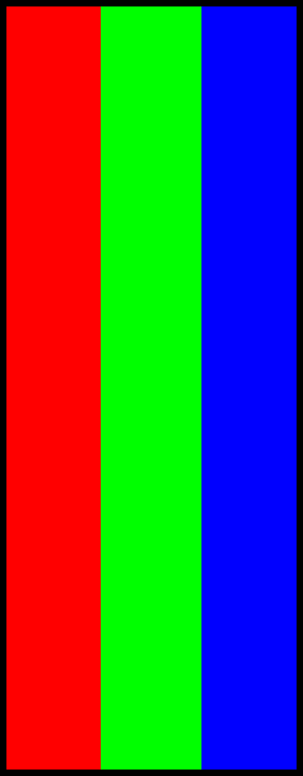

# JONSBO DS339 Minimal

JONSBO DS339に、背景画像と時計を合成した映像を定期送信するための軽量な常駐アプリケーションです。

Windowsを最初の動作対象とし、Linux向けビルドにも対応できる構成を目指します。

## 現在の状態

DS339の検出、映像送信、背景と時計の合成を行うCLIと設定GUIを実装しています。横置きの実機でテストパターンと時計が正常表示されることを確認済みです。GUIから送信の開始、設定の適用、停止ができます。

## 開発

Rustのstableツールチェーンを使用します。

```powershell
cargo fmt --all -- --check
cargo clippy --all-targets --all-features -- -D warnings
cargo test --all-targets --all-features
cargo build
cargo run
cargo run -- --test-pattern
cargo run -- --clock-once
cargo run -- --clock
cargo run --bin jonsbo-ds339-gui
```

`cargo run`はDS339のUSB ID `345F:9132`を検索し、HIDインターフェースと映像用Bulk OUTエンドポイント`0x04`を開けるか確認します。HIDではパネル接続状態レジスターを読み取りますが、画面設定の変更や映像送信は行いません。

Windowsでは純正ドライバーが導入する`libusb0.dll`を動的に利用します。Linuxでは`rusb`（libusb 1.0）を利用する構成です。

`--test-pattern`を指定した場合だけ、DS339をネイティブ解像度に設定してRGBカラーバーを1フレーム送信します。通常起動では画面内容を変更しません。

`--clock-once`は現在時刻を1フレーム送信します。`--clock`は1秒ごとに時計を更新し、`Ctrl+C`で終了します。現在は黒に近い背景、システムの既定サンセリフフォント、120px、白文字、中央配置の固定設定です。描画処理自体は背景画像、フォント名、サイズ、文字色、座標配置を受け取れる構成になっています。

`jonsbo-ds339-gui`はコンソールウィンドウを表示せずに設定画面を開くWindows向けGUI実行ファイルです。背景画像はパス入力または`Browse...`から選択でき、フォントはインストール済みフォントの一覧から選択できます。フォントサイズ、色、中央配置または座標を指定し、`Start / Apply`で1秒更新を開始します。

横置き時の出力プレビューは設定変更に追従し、送信中はDS339へ実際に送信できた合成フレームそのものを表示します。CLIの通常起動は、これまでどおり画面を変更せず接続確認だけを行います。

期待されるネイティブフレームは次の画像です。実機の取り付け方向では90度回転して表示される場合があります。



## 実装予定

1. ~~DS339の検出と接続~~
2. ~~テスト画像の送信~~
3. ~~背景画像と時計の合成~~
4. ~~設定GUI~~、タスクトレイ常駐
5. USB切断・再接続とスリープ復帰への対応
6. Linuxでのビルドと実機通信の検証
